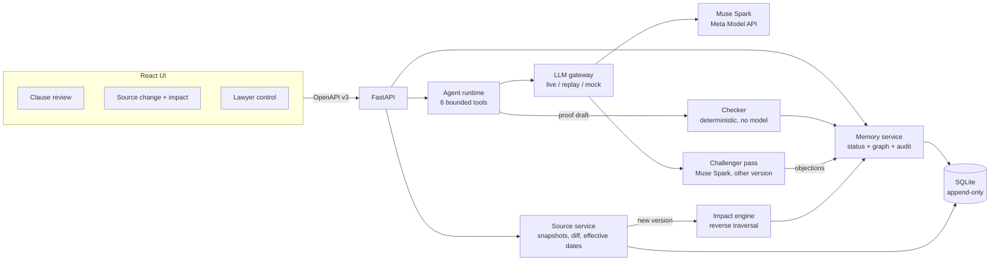

# ClauseTrace

When a law changes, ClauseTrace finds which legal conclusions depended on it, re-checks only those, and shows exactly why each follows — or why it can't be established.

A version-aware legal verification engine for the Meta Global AI Developer Hackathon (Indie Developer). Demo domain: India's DPDP Act 2023 / DPDP Rules 2025 applied to a fictional data-processing agreement (Acme Retail / Nimbus Analytics).

ClauseTrace shows what follows from accepted premises and stated source versions. It does not assert that the law or premises are true, and it is not legal advice.

**3-minute demo video:** not uploaded yet.

## Why it's different

- **A dependency graph says what to re-check.** When a source version changes, reverse traversal marks only the findings that actually depended on the changed provision. An unrelated decoy source flags none.
- **An independent checker validates proofs.** The checker is a separate Python package with no model and no network. It never imports the agent. Muse Spark drafts; it cannot set a finding's status.
- **History is never overwritten.** Findings, source versions, provisions, and the audit log are append-only. A stale finding is replaced by a new row; the old one stays.

## Architecture



Invariants: only `services/memory.py` decides FOLLOWS / RULED_OUT / UNKNOWN / REQUIRES_REVIEW. A stale finding is replaced only after a fresh `lookup_source` of the current version. Simulated amendments carry `is_simulated=true` and a SIMULATED badge.

## How Meta models are used

| Model | Used for | Bound |
|-------|----------|--------|
| Muse Spark (`muse-spark-1.3-contributor`) | Clause extraction, question → typed claim, six-tool proof loop | Temperature 0; max 12 tool calls; replay cassettes in CI |
| Muse Spark (`muse-spark-1.2`) | Challenger only: a different prompt that returns structured objections | Blocking objection → REQUIRES_REVIEW. Reviewer, not a second checker |
| Muse Spark Open | Not wired | Optional later (`CHALLENGER_PROVIDER=openweights`) |

Built during the hackathon with **Muse Spark** (Meta Model API in the verdict path) and **Muse Code** (backend lane). Frontend is in this repo's Cursor lane. Muse Image, SAM, and Muse Wonder are not used.

The UI Challenger panel **shows** a second-pass report only if the server was started with `CHALLENGER=on`. The checkbox does not turn the backend on.

## The six bounded tools

The model may call exactly these. No web search, no shell, no extra tools.

| Tool | Role |
|------|------|
| `lookup_source` | Provisions of a source at a version (default: valid on as-of). Max 5. |
| `list_dependent_claims` | Findings in this matter that depend on a source or provision. Max 20. |
| `get_premise` | One fact plus trust class and origin span. |
| `verify_derivation` | Run the deterministic checker on a draft proof. Read-only. |
| `propose_finding` | Propose a proof. The memory service re-checks it and sets status. The model cannot set status. |
| `request_lawyer_review` | Flag an item for a lawyer with a reason. |

Every query is scoped by `matter_id`. Cross-matter ids are rejected.

## What we built during the hackathon

See [`NEW_WORK.md`](NEW_WORK.md). The public repo started on Day 1 before application code; the first commit is docs and the licence.

## Honest limitations

- One fictional contract and a small official DPDP corpus. No real client or personal data.
- Rule cards were written by the developer from official text. No lawyer has reviewed them.
- The simulated DPDP Act v2 amendment is labelled SIMULATED.
- Not legal advice. No compliance certification.
- Replay mode answers only recorded questions and as-of dates. Anything else needs `LLM_MODE=live` and a Meta API key.
- Open-weights challenger is not wired.

## Run (replay, no API key)

```bash
make setup
cp env.example .env
make reset-demo
```

Two terminals:

```bash
# API — contract v3, replay, demo routes
cd backend && set -a; [ -f ../.env ] && . ../.env; set +a
API_STUB=0 LLM_MODE=replay DEMO_MODE=1 CHALLENGER=on \
  .venv/bin/uvicorn app.main:app --port 8000 --reload

cd frontend && npm run dev
```

- UI: http://localhost:5173 · API: http://localhost:8000
- Vite proxies `/api` to `http://127.0.0.1:8000`.
- Always `make reset-demo` before a demo or `make record`. Approving a fact mints new rows and breaks cassette hashes.
- Screen 1 default question: `Does clause 9.2 require Nimbus to keep transfer logs?` Recorded as-of dates: **2026-11-20** (default) and **2025-10-17**.
- Run Screen 1 before Screen 3 (lawyer control uses that `claim_id`).
- UNKNOWN-typed questions store UNKNOWN without drafting a proof. If the challenger cassette is missing, the finding is kept as REQUIRES_REVIEW (not a 502).
- Backend image: `docker build -f backend/Dockerfile -t clausetrace-backend .` Compose file is not in-repo yet.
- Unit tests still use `openapi/examples` mocks (`MODE=test` or `VITE_USE_MOCKS=1`).

Live model calls: set `MODEL_API_KEY` in `.env`, `LLM_MODE=live`. Tests never use live.

## Checks

```bash
make check-frontend   # oxlint + vitest
make check-backend    # ruff, mypy, pytest
make check            # both (human)
```

Latest logged backend run: pytest **215/215** (2026-11-02, including T8.1 scenarios). Frontend: vitest in this lane.

## Source provenance

Official DPDP Act 2023, DPDP Rules 2025, commencement notification G.S.R. 843(E), and the unrelated decoy (Emblems Act 1950) are listed with retrieval dates in [`NOTICE.md`](NOTICE.md). The Master DPA text is fictional and written for this project.
