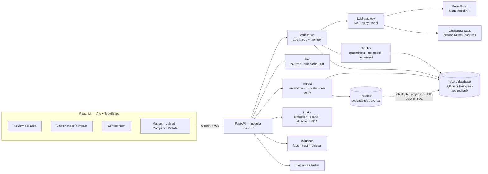
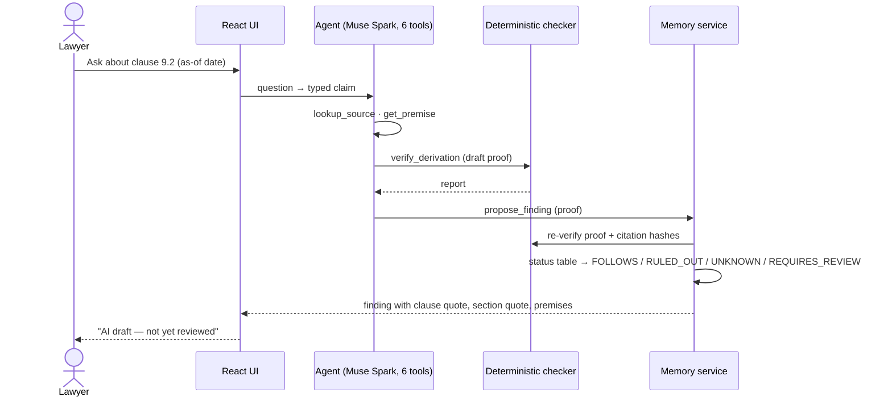
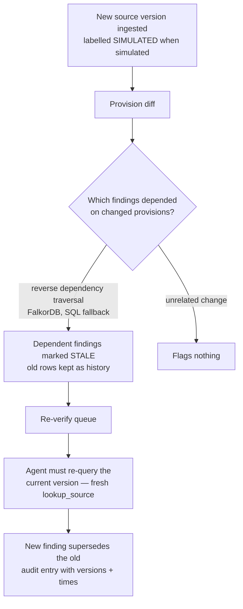
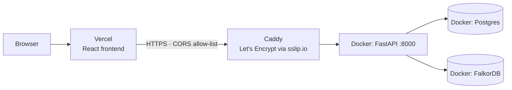

# ClauseTrace

When a law changes, ClauseTrace finds which legal conclusions depended on it, re-checks only those, and shows exactly why each follows — or why it can't be established.

A version-aware legal verification engine, started at the Meta Global AI Developer Hackathon. Demo domain: India's DPDP Act 2023 / DPDP Rules 2025 applied to a fictional data-processing agreement (Acme Retail / Nimbus Analytics).

ClauseTrace shows what follows from accepted premises and stated source versions. It does not assert that the law or premises are true, and it is not legal advice.

**3-minute demo video:** https://youtu.be/dTUU6wS-3lI
**Live demo:** https://meta-global-ai-developer-hackathon.vercel.app (sign in, then Review a clause — ask about clause 9.2)

## Why it's different

- **A dependency graph says what to re-check.** When a source version changes, reverse traversal marks only the findings that actually depended on the changed provision. An unrelated decoy source flags none.
- **An independent checker validates proofs.** The checker is a separate Python package with no model and no network. It never imports the agent. Muse Spark drafts; it cannot set a finding's status.
- **Validity is decided by propositional logic, deterministically.** Each proof is also checked as propositions (premises + inference rule ⊢ conclusion), which powers the what-if preview and the conflicting-interpretations state.
- **History is never overwritten.** Findings, source versions, provisions, and the audit log are append-only. A stale finding is replaced by a new row; the old one stays.

## What it does

- **Review a clause** — ask a question, get a checked answer with numbered reasoning, exact clause and section quotes, and the facts relied on (each labelled: confirmed by you / taken from the document / proposed, not yet approved).
- **Law changes** — preview a law change without saving anything (what-if), apply it, see only the affected answers move to a re-check queue, re-check them, and compare before/after answers.
- **Conflicting readings** — when two legal tests cited in one proof contradict each other, the answer is stored as "Two readings of the law conflict — your call", never silently resolved.
- **Your control room** — approve or challenge facts (approval mints a new confirmed copy; nothing is edited), correct fact wording, dictate a fact by voice or add a scanned page — both arrive as *proposed* facts that cannot support any answer until a lawyer approves them.
- **Evidence page** — every answer has a page with its reasoning, citations, facts, and earlier versions.
- Uploads run as tracked background jobs, including PDF files (text layer read directly; image-only pages transcribed, with a per-page confidence flag for spot-checking).
- **Contract understanding** — parties, obligations grouped by who owes them, defined terms and key dates extracted from the uploaded document, all as proposed items until a lawyer confirms them.
- **Readability layer** — a suggestion-labelled document summary and per-clause plain-language explanations (what it says / who it binds / what triggers it / worth checking), confirmable or dismissible by the lawyer. AI suggestions may be wrong; this is not legal advice.
- **Compare documents** — two documents aligned clause by clause, differing wording flaggable for review, plus a per-clause "which law it touches" roll-up.
- **Relevant sections search** — any wording ranked against every current law (DPDP Act + Rules, IT Act 2000, Copyright Act 1957), with an optional AI re-rank that explains each match.
- **Legal test drafting queue** — the model drafts rule cards from provisions; only a lawyer's confirmation makes a test relied-on.
- **Multi-matter workspace** — sign in, create matters, switch between them; everything is scoped to the selected matter.

## Architecture

Backend (Python 3.12, FastAPI) as a modular monolith with explicit domain boundaries (`backend/app/modules/`): **verification** (agent loop + memory, the only place a status is decided), **law** (sources, legal tests, diff), **impact** (amendment → stale → re-verify, what-if), **intake** (extraction, scans, dictation, PDF, jobs), **evidence** (facts, trust actions, graph), **matters**, **identity** (tenancy). The deterministic checker (`backend/checker/`, plus a propositional-logic module) is a pure library inside verification. Domain events (`finding.decided`, `fact.approved`, `impact.applied`) connect the modules.

Data (hybrid): SQLite for zero-setup local work, PostgreSQL via `CLAUSETRACE_DB_URL` for shared/production use — the same models run on both. Dependency traversal runs on **FalkorDB first** with an automatic fallback to the record database (the graph is a rebuildable projection of the relational record; the UI shows which served it). Retrieval is a small RAG: deterministic ranking over all provisions, concept expansion for statute-vs-lawyer wording, and an optional AI re-rank with per-hit reasons. Contract: `openapi/openapi.json`, currently **v22**, additive-only, with lawyer display labels beside every machine field. Frontend: React 18 + Vite + TypeScript, generated API types.

Invariants: only the memory service decides FOLLOWS / RULED_OUT / UNKNOWN / REQUIRES_REVIEW / CONFLICTING. A stale finding is replaced only after a fresh `lookup_source` of the current version. Premises must be lawyer-confirmed or document-extracted; AI-inferred facts can never support a proof. Simulated amendments carry a SIMULATED badge.

### System architecture



### Flow A — asking whether a clause follows



### Flow B — when the law changes



### Deployment



Data flow notes: the model can never write a finding's status, approve its own facts, or read another matter's data — every tool call is scoped by `matter_id`, and every citation is pinned to `(source_version_id, provision_id, span, sha256)` and checked verbatim against the stored snapshot.

## How Meta models are used

| Model | Used for | Bound |
|-------|----------|--------|
| Muse Spark (`muse-spark-1.3-contributor`) | Clause extraction, question → typed claim, six-tool proof loop, scanned-page transcription (image input) | Temperature 0; max 12 tool calls; replay cassettes in CI |
| Muse Spark (`muse-spark-1.2`) | Challenger only: a different prompt returning structured objections | Blocking objection → REQUIRES_REVIEW. Reviewer, not a second checker |
| Muse Voice Transcribe (`muse-voice-transcribe-1.0`) | Voice dictation → transcript → proposed fact | Stored `ai_inferred`; inadmissible until a lawyer approves it |
| Muse Spark Open | Not wired | Optional later (`CHALLENGER_PROVIDER=openweights`) |

Every model call goes through one gateway with per-tenant spend metering and an optional budget cap (`CT_TENANT_BUDGET_USD`). A golden-set evaluation harness (`scripts/run_evals.py`) gates releases: verdict agreement must be total and premise-admission violations zero. The UI Challenger panel **shows** a second-pass report only if the server was started with `CHALLENGER=on`.

## The six bounded tools

The model may call exactly these. No web search, no shell, no extra tools.

| Tool | Role |
|------|------|
| `lookup_source` | Provisions of a source at a version (default: valid on as-of). Max 5. |
| `list_dependent_claims` | Findings in this matter that depend on a source or provision. Max 20. |
| `get_premise` | One fact plus trust class and origin span. |
| `verify_derivation` | Run the deterministic checker on a draft proof. Read-only. |
| `propose_finding` | Propose a proof. The memory service re-checks it and sets status. The model cannot set status. |
| `request_lawyer_review` | Flag an item for a lawyer with a reason. |

Every query is scoped by `matter_id`. Cross-matter ids are rejected.

## What we built during the hackathon

See [`NEW_WORK.md`](NEW_WORK.md). The public repo started on Day 1 before application code; the first commit is docs and the licence. The production-grade rewrite that followed the demo (modular services, Postgres/graph data layer, intake pipelines, eval gate) is designed in [`docs/rewrite/`](docs/rewrite/).

## Honest limitations

- Demo data is fictional (one seeded contract plus a variant for upload testing). The law corpus is real and official: DPDP Act 2023 (18 provisions), DPDP Rules 2025, IT Act 2000 and Copyright Act 1957 (55 provisions total). No real client or personal data.
- Seeded rule cards stay `ai_inferred` until a lawyer confirms them in the Control room queue (the model can also draft new ones there). No practising lawyer has reviewed the seeded cards yet.
- The simulated DPDP Act v2 amendment is labelled SIMULATED.
- Not legal advice. No compliance certification.
- Replay mode answers only recorded questions and as-of dates. Anything else needs `LLM_MODE=live` and a Meta API key.
- Multi-matter workspaces with membership ship today; auth enforcement is opt-in (`CT_AUTH_REQUIRED=1`) and needs a login-first route guard before it should become the default. Deep dynamic claim-typing in the agent loop is future work — unverifiable proofs still default to REQUIRES_REVIEW.
- Open-weights challenger is not wired.

## Getting started

### Prerequisites
- **Python 3.12** and **Node 20+** (frontend), or just **Docker** for the one-command stack.
- `poppler-utils` (`pdftoppm`) for scanned-PDF transcription: `sudo apt install poppler-utils` (Debian/Ubuntu) — already inside the Docker image.
- No GPU, no paid services. The demo domain data is fictional.

### Do I need an API key?
**No — not to run, demo, or test.** The default `LLM_MODE=replay` answers from recorded cassettes offline at zero cost.

You need exactly **one key** only for live model calls (new questions, new documents, live dictation):

| Key | What it is | Where to get it | Used for |
|-----|-----------|---------------|----------|
| `MODEL_API_KEY` | Meta Model API key (`https://api.meta.ai/v1`) | Your Meta developer account | Muse Spark (proofs, extraction, explanations), Muse Spark challenger, voice transcription |

That is the only secret in the system. Everything else runs keyless.

### Environment (`.env`)
Copy the template and fill in what you use — every variable is optional except `MODEL_API_KEY` in live mode:

```bash
cp .env.example .env
```

| Variable | Default | Needed when |
|----------|---------|-------------|
| `MODEL_API_KEY` | *(empty)* | Only with `LLM_MODE=live` |
| `LLM_MODE` | `replay` | `live` = real model calls (spends credit); `mock` = placeholder text |
| `API_STUB` | `1` | Set `0` for the real API (the Docker stack already does) |
| `DEMO_MODE` | `0` (off) | `1` only for the scripted demo helpers (`/api/demo/reset`, scenarios) |
| `CLAUSETRACE_DB_URL` | *(unset → SQLite file)* | Postgres, e.g. `postgresql+psycopg://clausetrace:<pw>@127.0.0.1:5543/clausetrace` |
| `CLAUSETRACE_DB` | `backend/db.sqlite3` | Custom SQLite path |
| `POSTGRES_PASSWORD` | *(must set in `.env`)* | Password for `docker compose up` (Postgres + app share it; compose reads all secrets from `.env`) |
| `CT_GRAPH_HOST` / `CT_GRAPH_PORT` / `CT_GRAPH_PASSWORD` | `127.0.0.1` / `6379` / *(none)* | FalkorDB graph traversal (optional — the app falls back to the record database) |
| `CT_AUTH_REQUIRED` | `0` | `1` = bearer token required on `/api/*` |
| `CT_AUTH_SECRET` | dev default | **Must** be set to your own secret outside local dev |
| `CT_CORS_ORIGINS` | *(unset)* | Split hosting: your frontend origin, e.g. `https://your-app.vercel.app` |
| `CT_RATE_LIMIT_PER_MIN` | `0` (off) | Per-client write ceiling for production |
| `CT_TENANT_BUDGET_USD` | *(unset)* | Optional per-tenant model spend cap |
| `CHALLENGER` | `off` | `on` = second-review pass on every finding (extra model call) |

Frontend-only variables go in `frontend/.env.local`: `VITE_API_BASE` (API origin when not using the Vite proxy) and `VITE_USE_MOCKS=1` (fixture mode for UI-only work).

### Option A — Docker (one command, recommended)
```bash
cp .env.example .env          # defaults work; add MODEL_API_KEY only for live mode
Set POSTGRES_PASSWORD in .env, then docker compose up --build -d
curl http://127.0.0.1:8000/api/health     # {"status":"ok"}
```
Starts the API (:8000), Postgres (127.0.0.1:5543) and FalkorDB (127.0.0.1:6380), and seeds the demo database on first boot. Then run the UI: `cd frontend && npm install && npm run dev` → http://localhost:5173.

### Option B — Local processes (development)
```bash
make setup                    # backend .venv with all deps + frontend packages
cp .env.example .env
make reset-demo               # seed the demo database (~1s)
```
Two terminals:
```bash
# API (contract v22). API_STUB=0 = real router; leave LLM_MODE=replay for offline.
cd backend && set -a; [ -f ../.env ] && . ../.env; set +a
API_STUB=0 .venv/bin/uvicorn app.main:app --port 8000 --reload

# UI
cd frontend && npm run dev    # http://localhost:5173 (proxies /api to :8000)
```

### Going live (real model calls)
Set in `.env`, then restart the API (or `docker compose up -d`):
```bash
MODEL_API_KEY=<your-meta-model-api-key>
LLM_MODE=live
```
Recorded questions still answer instantly from cassettes; anything new calls the model (~$0.002 per question at current pricing; lifetime project spend so far ≈ $1 of the $150 budget). Tests never use live.

### Seed, reset, backup
```bash
make seed          # fill an empty database
make reset-demo    # wipe + reseed (follows CLAUSETRACE_DB_URL: SQLite file or Postgres)
sh scripts/backup_demo.sh --cassettes   # timestamped backup under backups/
```
Always `make reset-demo` before a demo or `make record`. Approving a fact mints new rows and changes replay hashes until the next reset.

### Deploy (split hosting)
- **Backend** on your server: the Docker stack above, behind HTTPS (Caddy reverse-proxy or a tunnel — browsers block an HTTPS page calling an HTTP API, and live dictation needs `wss://`).
- **Frontend** on Vercel: import the repo, set root directory `frontend`, set `VITE_API_BASE=https://<your-api-domain>`, and set `CT_CORS_ORIGINS=https://<your-app>.vercel.app` on the backend.

### Good to know
- You do **not** need `DEMO_MODE=1` for the app itself; asking, law changes, approvals, scans, dictation, clause updates, comparison and sign-in all work without it.
- Sign-in is at `/signin`. Create an account there first when `CT_AUTH_REQUIRED=1` (the compose stack enforces it if you set it).
- Default demo question: `Does clause 9.2 require Nimbus to keep transfer logs?` (as-of **2026-11-20**; also recorded: 2025-10-17). Run Review a clause before the Control room (it uses that session's claim).
- Upload a document from Your matters (PDF, DOCX, or text). After an upload, every screen works on that document. Text pages are read directly; scanned pages are transcribed and flagged "Check this page" so you can spot-check them before relying on answers.
- Dictate a fact on the Dictate page (microphone → transcript → save as proposed → confirm); toggle **Transcribe live** for streaming interim text. Saving clause wording always writes a new version — history is never edited.

## Checks

```bash
make check-frontend   # oxlint + vitest
make check-backend    # ruff, mypy, pytest
make check            # both (human)
```

Latest runs (2026-11-05): backend pytest **344 passed** (+3 infrastructure-gated skips), ruff and mypy clean; frontend vitest **53/53**, TypeScript and lint clean, production build passes; eval gate **5/5 with 0 premise violations** (also wired into CI). Contract is **v22**.

## Source provenance

Official DPDP Act 2023, DPDP Rules 2025, commencement notification G.S.R. 843(E), and the unrelated decoy (Emblems Act 1950) are listed with retrieval dates in [`NOTICE.md`](NOTICE.md). The Master DPA text and its Beacon/Stratus variant are fictional and written for this project.
