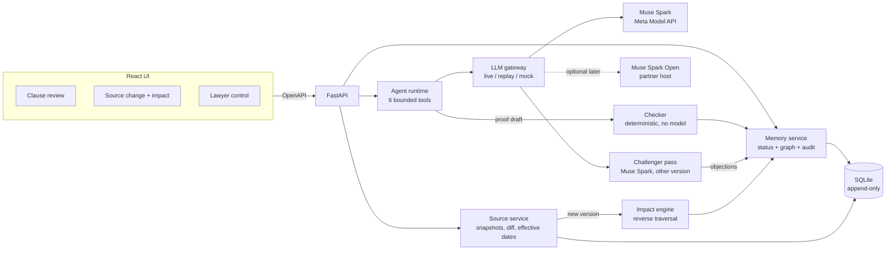

# ClauseTrace — Architecture

## 1. Stack choices (solo, 8 days, Python/FastAPI/React strengths)
| Layer | Choice | Alternative | Why |
|-------|--------|-------------|-----|
| Backend | Python 3.12 + FastAPI | Django | Fast to build, auto OpenAPI contract for the frontend |
| DB | SQLite (WAL) + SQLAlchemy 2 | PostgreSQL | One file, instant demo reset, triggers enforce append-only; swap to Postgres later if needed |
| Graph | Relational `edges` table + recursive CTE | Neo4j, networkx | No extra service; traversal is a few lines of SQL |
| Checker | Plain Python package `backend/checker` | Prolog/Z3/Lean | Small closed rule set; readable; no heavy deps |
| Frontend | React + Vite + TS + Tailwind | Streamlit | Streamlit looks like a generic chatbot; we need inspectable graph and diff views |
| Graph UI | React Flow | Cytoscape.js | Easy node/edge highlighting for the stale animation |
| Diff UI | `diff` library + custom side-by-side | react-diff-viewer | Full control, small |
| LLM access | OpenAI SDK pointed at `https://api.meta.ai/v1` (Responses API) | raw HTTP | Meta API is OpenAI-SDK compatible |
| Open weights (optional, later) | Baseten or Modal, model `meta-models/muse-spark-open-1026` | — | Only if you get partner access and time; your VM has no GPU, so no local serving. The core runs on the Meta Model API alone |
| Hosting | Docker Compose on your Ubuntu VM (12 GB RAM) behind Caddy/nginx | Fly/Render | Free, you control it; static frontend build + uvicorn |
| Tests | pytest, Vitest, replay cassettes | — | Zero credit use in CI |

## 2. System diagram


## 3. Components
- **Source service:** stores immutable `source_versions` (raw text + sha256 + effective dates + `is_simulated`), parses `provisions`, computes diffs by provision key and text hash. Ingestion only from an allowlist (India Code, MeitY) or a local fixture. The agent cannot call it directly.
- **Rule cards:** hand-curated YAML per provision (see §7), each citing a verbatim span. They are the explicit, inspectable interpretation layer and count as premises.
- **Memory service (`services/memory.py`):** the only writer of findings, finding events and graph edges. Decides current status, staleness, and which finding is "current" for a claim. The model never reads or sets "current".
- **Agent runtime:** Responses-API function-calling loop with exactly 6 tools, matter-scoped IDs, max 12 calls, full tool-call log.
- **LLM gateway:** one module for all model calls; modes `live|replay|mock`; logs tokens, cost estimate, latency.
- **Checker:** separate package, separate CLI (`python -m checker verify proof.json`), no model import. Also run in-process by the API.
- **Challenger:** a second Muse Spark pass (different version, `muse-spark-1.2`, and a different prompt than the proposer) gets the claim, premises and rule cards and returns structured objections. Any objection forces REQUIRES_REVIEW. Config `CHALLENGER_PROVIDER=meta|openweights` lets you swap this role to Muse Spark Open later without other changes. A second model pass is a reviewer, not independent verification; the deterministic checker is.
- **Impact engine:** on a new source version, diffs provisions, finds rule cards citing changed provisions or changed effective dates, finds dependent findings by reverse traversal, writes stale events, queues re-verification.
- **Audit service:** append-only `audit_log` for every state change, with actor (`lawyer|system|model`).

## 4. Flows
### A. Verify a claim
1. UI posts `{clause_id, question, as_of}`.
2. Spark (structured output) converts the question to a typed claim (§7). Unsupported shape → UNKNOWN immediately.
3. Agent loop: `lookup_source` → `get_premise` → … → drafts a proof → `verify_derivation(claim_id, proof)` (read-only checker report) → `propose_finding(claim_id, proof)`.
4. Memory service re-runs the checker, verifies every citation hash, checks the tool log contains the needed lookups, runs the challenger, then applies the status table (§6) and writes the finding, graph edges, audit entry.
5. UI shows the finding with traces.

### B. Amendment impact
1. `POST /sources/{id}/ingest` loads a new version (fixture or official URL), stores it, computes provision diff.
2. Impact engine: changed provision keys (or effective-date changes) → rule cards citing them → findings depending on those cards or provisions (reverse DEPENDS_ON traversal) → append `STALE` events with reason.
3. Unaffected findings stay CURRENT. Decoy-source changes flag nothing.
4. `POST /impact/{id}/reverify`: for each stale finding, run Flow A again with `as_of` unchanged but source version = current. The memory service rejects a new finding unless the tool log shows a fresh `lookup_source` of the current version.
5. New finding row `supersedes` the old; old gets a `SUPERSEDED` event. Unchanged outcomes are recorded as "rechecked, same result".

### C. Premise challenge
Lawyer marks a fact disputed → fact trust class becomes `disputed` (new row/event) → reverse traversal finds findings using it → stale → re-verify: claim becomes UNKNOWN or REQUIRES_REVIEW if the premise is no longer admissible.

## 5. Proof format and checker
Proof (JSON) = list of typed steps. Each step cites ids that exist in the DB.
```json
{
  "claim_id": "C-001", "as_of": "2026-11-20",
  "steps": [
    {"id":"s1","kind":"cite_fact","fact":"F-014"},
    {"id":"s2","kind":"cite_rule","rule":"RC-003"},
    {"id":"s3","kind":"in_force","rule":"RC-003"},
    {"id":"s4","kind":"compare","left":{"fact":"F-014","field":"hours"},"op":"<=","right":{"rule":"RC-003","field":"max_hours"}},
    {"id":"s5","kind":"conclude","from":["s1","s2","s3","s4"],"conclusion":"clause_meets_bound"}
  ]
}
```
(Numbers and ids above are illustrative; real bounds come from rule cards verified against official text.)

**Checker validates, in order:**
1. Schema and step ordering (each step only uses earlier steps).
2. Every cited fact exists, belongs to the claim's matter, and has trust class `lawyer_confirmed` or `document_extracted`.
3. Every cited rule card exists and is not superseded; its cited provision span matches the stored snapshot text (substring) and sha256.
4. `in_force`: `effective_from <= as_of < effective_until` using the source version valid for `as_of`.
5. `compare` / `contains_element` / `role_applies`: re-evaluated by the checker itself from stored data (never trusts model-supplied values).
6. `conclude` follows from cited steps under the fixed rule set (conjunction + implication). For RULED_OUT the conclusion is the negation under the same rules.
7. Every cited source version is the one that was valid at `as_of` and, on re-verification, the **current** version.

**What the checker does not establish:** that a premise is true, that a rule card is the correct legal interpretation, or that the law is true. The UI says so.

## 6. Status and confidence (memory service)
| Condition | Status |
|-----------|--------|
| Claim shape unsupported, or no applicable rule card/provision, or a required premise missing | UNKNOWN |
| Checker PASS for the claim and challenger raises no objection | FOLLOWS |
| Checker PASS for the negation | RULED_OUT |
| Checker FAIL, challenger objection, premise disputed, or rule card needs interpretation | REQUIRES_REVIEW |
| (Stretch) two admissible rule cards disagree | CONFLICTING |

**Confidence band (computed, never asked of the model):**
- HIGH: all premises `lawyer_confirmed`, rule card `lawyer_confirmed`, provision in force at `as_of`, no challenger objection.
- MEDIUM: any premise is `document_extracted`.
- LOW: rule card flagged `interpretation`, or challenger raised a non-blocking note, or source version is simulated.

## 7. Claim types (closed set, so the checker stays tractable)
| Type | Example question | Checker test |
|------|------------------|--------------|
| CT1 `numeric_bound` | "Does clause 9.2's breach-notice window meet the breach-reporting timeline?" | Fact value vs rule bound |
| CT2 `required_element` | "Does the agreement require the processor to delete data when instructed?" | Clause contains element required by rule card |
| CT3 `in_force_on` | "Is this obligation in force on 2026-11-20?" | Effective-date test |
| CT4 `role_applies` | "Is Nimbus a Data Processor under this agreement?" | Role predicate over extracted facts |
Anything else → UNKNOWN with explanation.

## 8. Model routing
| Task | Model | Notes |
|------|-------|-------|
| Clause extraction, candidate facts | `muse-spark-1.3` | Structured output, temp 0 |
| Question → typed claim | `muse-spark-1.3` | Structured output |
| Agent loop + proof drafting | `muse-spark-1.3` | Tool calling; fall back to `muse-spark-1.2` if 1.3 misbehaves |
| Challenger (second pass) | `muse-spark-1.2` | Different version and prompt than the proposer. Optional later: Muse Spark Open via a partner host |
| Dictation (stretch) | `muse-voice-transcribe-1.0` | Audio → text → proposed fact → lawyer approval |
| Scan ingestion (stretch) | `muse-spark-1.3` with PDF/image input | Not Muse Image (that generates images) |
| Verification | **No model** | Deterministic checker |
Check `https://dev.meta.ai/docs/models` for current ids; note "audio understanding in Spark 1.3 is not fully supported" — use Voice Transcribe for audio.

## 9. Credit budget ($150)
Per-token prices are on the Meta Pricing page; measure real cost in T0.3 and write the numbers into `PROGRESS.md`.
- Allocation: ~$100 development (≈$14/day over 7 days), ~$30 final recording and rehearsals, ~$20 reserve.
- Tactics: replay cassettes for tests and demo rehearsal; small structured prompts; extraction runs once per document and is cached; temp 0; cap tool calls at 12; challenger only on final proofs.
- The Meta pricing page mentions a discounted "Contributor mode" for Muse Spark — read what it implies for data use before enabling it (demo data is fictional, so likely fine).
- Set the spend limit notification on the Billing page. A credit card is required to use credits.

## 10. Corpus (verify every reference in T0.6 before use)
- S1 DPDP Act 2023 (expected provisions: processor engagement by contract, security safeguards, breach intimation, erasure).
- S2 DPDP Rules 2025 (expected: security safeguards, breach intimation timelines, erasure, commencement rule).
- S3 Commencement notification(s) — phased dates, so as-of date matters.
- S4 Decoy: an unrelated official instrument, used to prove irrelevant changes flag nothing.
- Simulated amendment `S2 v2` (**SIMULATED, not an official notification**): e.g., an altered commencement date or a changed time limit, to exercise the pipeline. Prefer real official history if a real change exists by Day 6.
- Contract: fictional Master Data Processing Agreement, Acme Retail Pvt Ltd (Data Fiduciary) and Nimbus Analytics Pvt Ltd (Data Processor), about 12 clauses.
- Rights: official government texts with URL and retrieval date in `NOTICE.md`; no paid databases.

## 11. Security and isolation
Every query filters by `matter_id`; tool args are validated against the session's matter; secrets only in `.env`; no PII; the agent has no network, shell or file tools; ingestion allowlist enforced in the source service; demo-reset endpoints behind `DEMO_MODE=1`.

## 12. Deployment
Docker Compose: `api` (uvicorn), `web` (static build via Caddy), SQLite volume. `make reset-demo` seeds the matter, corpus, extracted clauses and cassettes. Keep a pre-recorded video of the full demo path as a fallback.

## 13. Top risks and mitigations
| Risk | Mitigation |
|------|-----------|
| Looks like basic RAG | Demo leads with amendment → stale → re-verify; checker tamper test; README table |
| Model output unreliable | Structured output, temp 0, checker as gate, UNKNOWN as safe default, replay cassettes |
| Checker scope creeps into a theorem prover | Closed claim types and 6 step kinds only |
| Credits run out | Replay mode, budget in PROGRESS.md, spend alert |
| Legal content errors | Verify cards against official text; label demo premises; disclaimer; no compliance claims |
| UI not ready | Cursor builds against mocks from Day 3; core demo scripted via API if needed |
| "Political" reading | Commercial-contract framing, neutral examples, no government-vs-citizen content |
| No open-weights access (partner credits not requested) | Core is Meta-API-only; open weights is an optional swap behind `CHALLENGER_PROVIDER`; the open-weights bonus is simply not targeted unless T7.5 happens |
