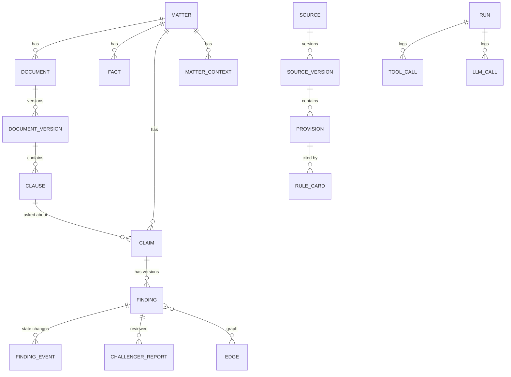

# ClauseTrace — Data Model, Tool Contract, API

IDs are prefixed strings (`SRC-`, `SV-`, `PRV-`, `RC-`, `DOC-`, `CL-`, `F-`, `C-`, `FND-`). Timestamps are UTC ISO-8601; legal dates are plain dates. Feature IDs (F1…) refer to `PRD.md`.

## 1. ER diagram


## 2. Tables
| Table | Key fields | Notes (feature) |
|-------|-----------|-----------------|
| `matters` | id, client_name (fictional), title | F18 |
| `matter_context` | id, matter_id, kind (`hearing`/`task`), title, due_at, source_label | Static demo data, shown with "demo data" label (F18) |
| `sources` | id, key, title, publisher, url, jurisdiction | F1 |
| `source_versions` | id, source_id, version_label, published_on, effective_from, effective_until?, retrieved_at, content_sha256, raw_text, is_simulated, supersedes_id? | **Append-only** (F1, F11, F13) |
| `provisions` | id, source_version_id, key (e.g. `Rule 7(2)`), text, text_sha256, effective_from, effective_until? | **Append-only** (F2) |
| `rule_cards` | id, provision_id, kind (`statutory`/`interpretation`), claim_type, predicate_json, interpretation_text, span_start, span_end, trust_class, approved_by, created_at, superseded_by? | Hand-curated (F2) |
| `documents` | id, matter_id, title, kind | F3 |
| `document_versions` | id, document_id, text, sha256, created_at | F3 |
| `clauses` | id, document_version_id, ref (`9.2`), heading, text, span_start, span_end | F3 |
| `facts` | id, matter_id, clause_id?, statement, structured_json, origin (`extracted`/`lawyer`/`dictated`/`ai_inferred`), trust_class, created_at, approved_by?, approved_at?, supersedes_id? | Trust change = new row (F8, F15) |
| `claims` | id, matter_id, clause_id, claim_type, params_json, question_text, as_of, created_at | F4 |
| `findings` | id, claim_id, version_no, status, confidence_band, proof_json, as_of, source_version_ids_json, premise_ids_json, rule_card_ids_json, checker_report_json, run_id, created_at, supersedes_finding_id? | **Append-only** (F7) |
| `finding_events` | id, finding_id, state (`CURRENT`/`STALE`/`SUPERSEDED`/`REVIEWED`/`REJECTED`), reason, caused_by_type, caused_by_id, created_at | Append-only state log (F11, F12, F16) |
| `challenger_reports` | id, claim_id, finding_id?, model, objections_json, created_at | F17 |
| `edges` | id, src_type, src_id, dst_type, dst_id, rel, created_at | F10 |
| `runs` | id, trigger (`verify`/`reverify`), claim_id, started_at, ended_at, outcome | |
| `tool_calls` | id, run_id, seq, tool, args_json, result_json, ok, created_at | Re-query enforcement (F12) |
| `llm_calls` | id, run_id?, role, model, request_sha256, tokens_in, tokens_out, cost_est, latency_ms, cached | Credit tracking |
| `reviews` | id, item_type, item_id, reason, status, reviewer, note, created_at | F15, F16 |
| `audit_log` | id, ts, actor_type (`lawyer`/`system`/`model`), actor_id, event, object_type, object_id, details_json | **Append-only** (F14) |

Trust classes: `lawyer_confirmed`, `document_extracted`, `ai_inferred`, `disputed`. Admitted into proofs: first two only.

### Append-only enforcement (SQLite)
```sql
CREATE TRIGGER findings_no_update BEFORE UPDATE ON findings
BEGIN SELECT RAISE(ABORT, 'findings are append-only'); END;
CREATE TRIGGER findings_no_delete BEFORE DELETE ON findings
BEGIN SELECT RAISE(ABORT, 'findings are append-only'); END;
-- repeat for source_versions, provisions, audit_log
```

## 3. Graph edges
| rel | src → dst | Meaning |
|-----|-----------|---------|
| `PART_OF` | clause → document_version; provision → source_version | Containment |
| `DERIVED_FROM` | rule_card → provision; fact → clause | Origin of an item |
| `DEPENDS_ON` | finding → fact / rule_card / provision | What a conclusion relied on |
| `SUPERSEDES` | source_version → source_version; finding → finding | History chain |
| `AFFECTS` | provision → rule_card (on change) | Written by the impact engine |

Reverse traversal (recursive CTE) from a changed provision: `provision ← DERIVED_FROM ← rule_card ← DEPENDS_ON ← finding`. Only findings whose latest event is `CURRENT` are marked stale.

## 4. Bounded tool contract (exactly six)
The session fixes `matter_id`; any tool arg pointing to another matter is rejected. Max 12 tool calls per run. All calls are logged in `tool_calls`. Format shown is the Responses API function-tool shape.

```json
[
 {"type":"function","name":"lookup_source",
  "description":"Fetch provisions of a source at a specific version (default: the version valid on as_of). Max 5 provisions returned.",
  "parameters":{"type":"object","properties":{
    "source_id":{"type":"string"},
    "version":{"type":"string","description":"'current' or a source_version id"},
    "provision_key":{"type":"string"}},
   "required":["source_id"],"additionalProperties":false}},
 {"type":"function","name":"list_dependent_claims",
  "description":"List claims/findings in this matter that depend on a source or provision. Max 20.",
  "parameters":{"type":"object","properties":{
    "source_id":{"type":"string"},"provision_key":{"type":"string"}},
   "required":["source_id"],"additionalProperties":false}},
 {"type":"function","name":"get_premise",
  "description":"Fetch one fact with its trust class and origin span.",
  "parameters":{"type":"object","properties":{
    "matter_id":{"type":"string"},"premise_id":{"type":"string"}},
   "required":["matter_id","premise_id"],"additionalProperties":false}},
 {"type":"function","name":"verify_derivation",
  "description":"Run the deterministic checker on a draft proof. Read-only; changes no state.",
  "parameters":{"type":"object","properties":{
    "claim_id":{"type":"string"},"proof":{"type":"object"}},
   "required":["claim_id","proof"],"additionalProperties":false}},
 {"type":"function","name":"propose_finding",
  "description":"Propose a proof for a claim. The memory service re-checks it and decides the status. You cannot set a status.",
  "parameters":{"type":"object","properties":{
    "claim_id":{"type":"string"},"proof":{"type":"object"}},
   "required":["claim_id","proof"],"additionalProperties":false}},
 {"type":"function","name":"request_lawyer_review",
  "description":"Flag an item for lawyer review with a reason.",
  "parameters":{"type":"object","properties":{
    "item_type":{"type":"string","enum":["claim","finding","fact","rule_card"]},
    "item_id":{"type":"string"},"reason":{"type":"string"}},
   "required":["item_type","item_id","reason"],"additionalProperties":false}}
]
```
Return shapes:
- `lookup_source` → `{source_version_id, version_label, effective_from, effective_until, is_simulated, provisions:[{provision_id, key, text, sha256}], truncated}`
- `list_dependent_claims` → `{items:[{claim_id, finding_id, state}]}`
- `get_premise` → `{fact_id, statement, structured, trust_class, origin:{clause_id, span}}`
- `verify_derivation` → `{valid, errors:[{step, code, message}], cited_source_versions:[...]}`
- `propose_finding` → `{accepted, finding_id?, status?, rejection_reason?}`
- `request_lawyer_review` → `{review_id}`

Differences from the early brainstorm: `record_finding(claim_id, status, proof)` became `propose_finding(claim_id, proof)` (the model cannot set status), and `verify_derivation` takes the proof, so the checker validates what the model actually proposes.

## 5. Status decision (memory service pseudo-code)
```python
def decide(claim, proof, as_of):
    if claim.type not in SUPPORTED or no_rule_card(claim): return UNKNOWN
    rep = checker.verify(claim, proof, as_of)          # deterministic
    tool_log_ok = log_has_fresh_lookup(run, rep.cited_source_versions)
    if not tool_log_ok: reject("stale citation or missing lookup")
    obj = challenger.review(claim, proof)              # second Muse Spark pass
    if not rep.valid or obj.blocking or rep.has_disputed_premise: return REQUIRES_REVIEW
    return FOLLOWS if rep.conclusion == "holds" else RULED_OUT
```
Confidence band: see ARCHITECTURE §6.

## 6. Amendment flow (data steps)
1. Insert `source_versions` (v2, `supersedes_id`=v1) and its `provisions`.
2. Diff by provision `key` + `text_sha256`, plus effective-date changes.
3. Insert `AFFECTS` edges provision(v1 key) → rule cards citing that key; create replacement rule cards only via human action (rule cards are not auto-rewritten).
4. Reverse traversal → insert `finding_events(STALE, reason, caused_by=source_version v2)`; write audit rows.
5. Re-verify each stale finding → new `findings` row (`supersedes_finding_id`) → events: old `SUPERSEDED`, new `CURRENT`.
6. If the new outcome equals the old, record `audit_log: rechecked, unchanged`.

## 7. REST API (all under `/api`; JSON)
| Method + path | Purpose | Feature |
|---------------|---------|---------|
| `GET /health` | liveness | — |
| `GET /matters/{id}` | matter + context panel | F18 |
| `GET /matters/{id}/documents` · `GET /documents/{id}/clauses` | clause list | F3 |
| `POST /documents/{id}/extract` | Spark extraction → clauses + candidate facts (`document_extracted`) | F3 |
| `GET /matters/{id}/facts` | facts with trust class | F8 |
| `POST /facts/{id}/approve` · `/challenge` · `/reject` | lawyer action, creates new trust-class row, triggers recompute | F15 |
| `POST /claims` `{clause_id, question, as_of}` | structure claim and start run → `{claim_id, run_id}` | F4, F5 |
| `GET /runs/{id}` · `GET /runs/{id}/events` (SSE) | status + live tool-call trace | F5 |
| `GET /claims/{id}/current` | current finding (decided by memory service) | F7 |
| `GET /claims/{id}/history` | all finding versions | F12 |
| `GET /findings/{id}` | proof, traces, what-would-change, checker report, challenger report | F9 |
| `POST /findings/{id}/review` `{action, note}` | approve/reject/annotate → `REVIEWED` event | F16 |
| `GET /sources` · `GET /sources/{id}/versions` | registry | F1 |
| `GET /source-versions/{id}/diff?against={id}` | side-by-side diff data | F11 |
| `POST /sources/{id}/ingest` `{fixture? , url?}` | new version + impact report | F11 |
| `GET /impact/{id}` | affected findings, graph slice | F11 |
| `POST /impact/{id}/reverify` | re-run stale findings | F12 |
| `GET /graph?matter_id=&focus=` | nodes + edges for React Flow | F10 |
| `GET /audit?matter_id=` | audit trail | F14 |
| `POST /proofs/verify` | tamper demo: run checker on edited proof | G8 |
| `POST /counterfactual` (stretch) | read-only "what if" traversal | F19 |
| `POST /demo/reset` · `/demo/scenario/{name}` | seed state, only if `DEMO_MODE=1` | — |

Error shape: `{"error": {"code": "PROOF_REJECTED", "message": "...", "details": {...}}}`.

## 8. Edge cases and validation rules
- A fact's `structured_json` must match the schema of its claim type; otherwise it cannot be cited.
- A quote in a proof must be a verbatim substring of the cited provision text; whitespace normalised, nothing else.
- `as_of` earlier than every `effective_from` → provision "not in force" → UNKNOWN/RULED_OUT per rule card.
- Re-approving a fact creates a new row; older findings stay tied to the old row.
- Concurrent ingest of the same version is idempotent (same `content_sha256` → no new version).
- Source fetch failure → `SourceUnavailable`; UI shows "not checked", never "up to date".

## 9. Feasibility flags
- Parsing official PDFs into provisions can be messy: store cleaned text by hand for the 5–8 provisions you need (T1.2).
- Real amendment history may not exist in time: use the labelled simulation.
- CONFLICTING (F22) needs two competing rule cards: stretch only.
